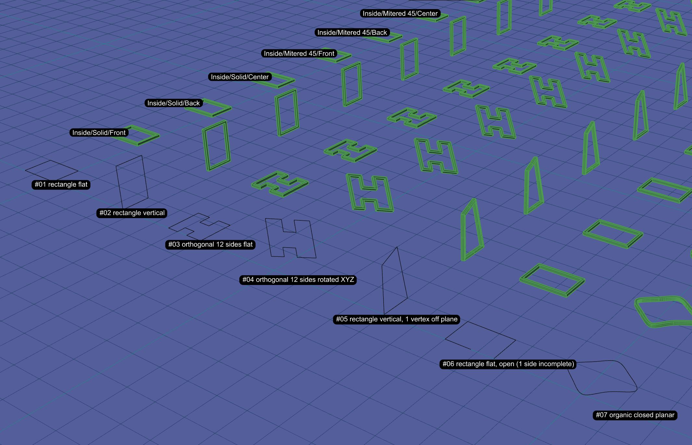
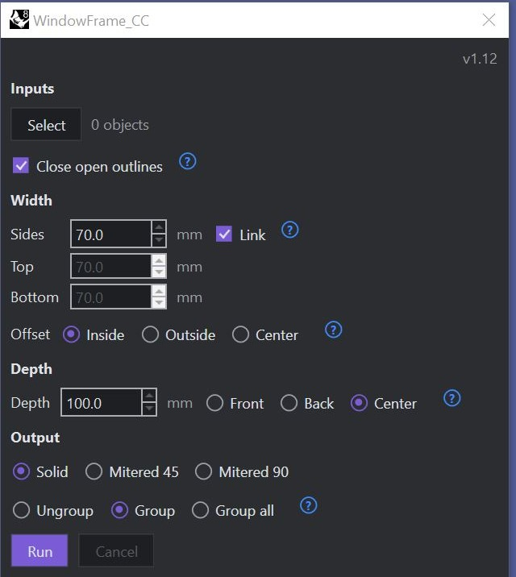

# WindowFrame_CC

**Français** · [English](README.md)

Un script Python pour Rhino 8 qui construit un **cadre de fenêtre** à section rectangulaire le long du contour extérieur de toute géométrie sélectionnée (courbes, surfaces, polysurfaces, maillages, SubD, hachures). Il ouvre une petite fenêtre flottante : sélectionne la géométrie, règle les largeurs, appuie sur **Run**. Un seul Ctrl+Z annule un Run, et tes objets d'entrée ne sont jamais modifiés.



Version **1.12** · Licence : [GPL-3.0 ou ultérieure](LICENSE) · Visite du code : [ARCHITECTURE.md](ARCHITECTURE.md) (en anglais)

## Captures


## Prérequis
Windows, Rhino 8 ou plus récent (Python 3 intégré). Aucun paquet supplémentaire.

## Installation
1. Télécharge `WindowFrame_CC.py` et place-le dans le dossier de ton choix.
2. Dans Rhino, crée un bouton de barre d'outils avec cette macro (adapte le chemin) :
   ```
   ! _-RunPythonScript "C:\Outils\WindowFrame_CC\WindowFrame_CC.py"
   ```

## Entrées
Courbes (ouvertes ou fermées), surfaces, polysurfaces, extrusions, maillages, SubD et hachures. Seul le bord extérieur est utilisé ; les trous sont ignorés, et un cadre est créé par contour. Les courbes qui se touchent, sélectionnées ensemble, sont jointes d'abord, et les contours ouverts peuvent être fermés automatiquement.

## Contribuer
Les améliorations sont bienvenues. Commence par [ARCHITECTURE.md](ARCHITECTURE.md), qui explique comment le fichier unique est organisé et où se trouve chaque étape. Pour signaler un bogue, ouvre une « issue » et joins le fichier correspondant du dossier `logs` que le plugin crée à côté du script. Historique des versions : [CHANGELOG.md](CHANGELOG.md).

## Licence
GNU General Public License v3.0 ou ultérieure : tu peux utiliser, étudier, modifier et partager ce code, et toute version modifiée et distribuée doit rester sous la même licence. Voir [LICENSE](LICENSE).
